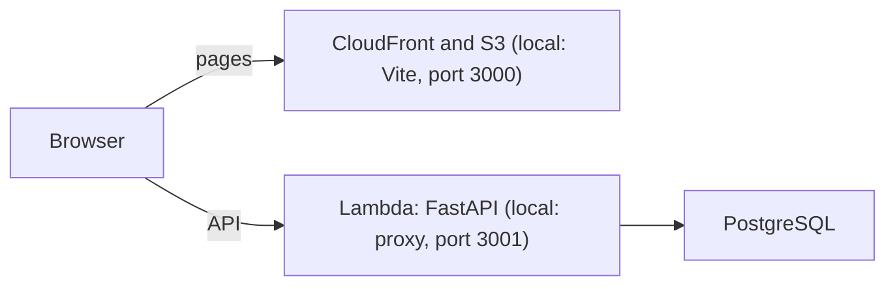

# ACME Project Management

A web application that gives ACME Inc. one place to see project progress, resource
allocation, deliverables, dependencies, budgets and risks. Built in the
[Coding Workshop](./docs/README.md) starter repository.

## Questions It Answers

| Question | Where |
|---|---|
| What is the status of each active project? | Dashboard, Projects |
| Which projects are at risk of missing deadlines? | Dashboard (reasons and forecast) |
| How are resources allocated? | Workload, a project's Team tab |
| What are the key deliverables and their status? | Deliverables |
| Who is over-allocated? | Resources |
| What is the dependency chain? | A project's Dependencies tab |
| How much budget is consumed versus planned? | Budgets |

## Features

* Sign-in with hashed passwords, expiring tokens and sign-out on every device
* Three roles, enforced by the backend: Admin, Project Manager and Team Member
* Projects, milestones, deliverables, resources, assignments, expenses and users
* Dependencies with automatic blocking and protection against circular chains
* Over-allocation, budget and risk detection with fixed, explainable rules
* Optional AI Insights that explain a project; fixed rules take over without AI
* Search, filters, sorting and paging in the backend
* Layouts for desktop, tablet and phone

## Technology

| Layer | Technology |
|---|---|
| Frontend | React, React Responsive, Material UI, Vite |
| Backend | Python, FastAPI, SQLAlchemy, Alembic |
| Database | PostgreSQL |
| AI (optional) | Google Gemini |
| Infrastructure | Terraform (Lambda, S3, CloudFront, Aurora), LocalStack for development |



## Structure

```
backend/project-service/   API, business rules and database migrations
frontend/src/              Pages, components, services, hooks and tests
tests/backend/             Backend tests, kept out of the Lambda package
bin/                       Scripts to start, deploy and add demo data
infra/                     Terraform
docs/                      Workshop guides
```

See the [backend guide](./backend/project-service/README.md) for endpoints and for the
dependency, workload, budget and risk rules.

## Run It Locally

Set up the machine first with the [Validation Guide](./docs/validation.md). Then:

```sh
./bin/start-dev.sh
```

Open <http://localhost:3000>. Before the first use, prepare the Python tools, the
database and an admin account. There is no default password:

```sh
python3.13 -m venv .venv
.venv/bin/python -m pip install -r tests/backend/requirements-dev.txt

cd backend/project-service
export IS_LOCAL=true POSTGRES_PASS=<local database password>
../../.venv/bin/alembic upgrade head
../../.venv/bin/python -m app.cli --email you@example.com --name "Your Name"
```

### Demo Data

Adds 12 fictional projects with everything inside them. It only adds records, works on
the local database only, and adds nothing when run again:

```sh
.venv/bin/python bin/seed-demo.py            # Dry run
.venv/bin/python bin/seed-demo.py --insert
```

To show demo logins on the local sign-in page, create
`frontend/.env.development.local`. Git ignores it and production builds never read it:

```sh
VITE_DEMO_ACCOUNTS='[{"label":"Admin","email":"...","password":"..."}]'
```

### AI Insights

A project's AI Insights tab works without AI, with fixed rules. To use Google Gemini,
store your own API key in the local backend. The script asks for it and keeps it in no
file. On Google's free tier, use demo data only:

```sh
./bin/set-ai-key.sh
```

## Tests

```sh
export POSTGRES_PASS=<local database password>
.venv/bin/python -m pytest tests/backend     # Uses a temporary database
cd frontend && npm test && npm run lint
```

Last full run on 24 November 2026: 688 backend and 140 frontend tests passed, with no
Bandit or npm audit findings. A browser audit of every feature also passed; its scripts
are not part of this repository.

## Design Decisions

* **One service, split by feature.** Projects, resources and budgets are queried
  together, and Lambdas here cannot share code.
* **Totals are calculated, not stored.** Progress, spending and workload cannot
  disagree with the records.
* **AI explains and never calculates.** The backend fills in every figure, and AI
  cannot change records.
* **Rules live in the backend and the database.** The frontend only hides what the
  backend would refuse.

## Known Limits

* Open pages do not refresh by themselves.
* Team leads use the Project Manager role.
* The free AI service is sometimes busy or slow. The app then shows its fixed rules.
* Not load tested, and test coverage has not been measured.
* Not deployed to AWS yet. Before that, the CloudFront rule that turns 404 responses
  into pages and the 128 MB Lambda memory need to change.

## Contributing

See the [CONTRIBUTING](./CONTRIBUTING.md) resource for more details.

## License

This library is licensed under the MIT-0 License.
See the [LICENSE](./LICENSE) resource for more details.

## Roadmap

See the
[open issues](https://github.com/citi/coding-workshop-participant/issues)
for a list of proposed roadmap features (and known issues).

## Security

See the
[Security Issue Notifications](./CONTRIBUTING.md#security-issue-notifications)
resource for more details.

## Authors

The following people have contributed to this workshop:

* Colin Heilman - [@heilmancs](https://github.com/heilmancs)
* Eugene Istrati - [@eistrati](https://github.com/eistrati)
* Isaiah Cornelius Smith - [@corneliusmith](https://github.com/corneliusmith)
* Juan Arevalo - [@jparevalo27](https://github.com/jparevalo27)
* Michael Annucci - [@michael-annucci](https://github.com/michael-annucci)

## Feedback

We'd love to hear your feedback! Please:

* ⭐ Star the repository if you find it helpful
* 🐛 Report issues on GitHub
* 💡 Suggest improvements
* 📝 Share your experience
